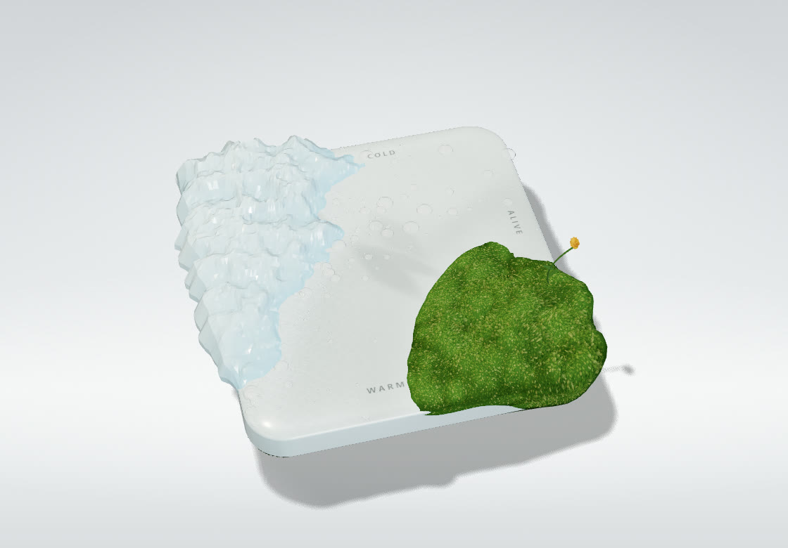
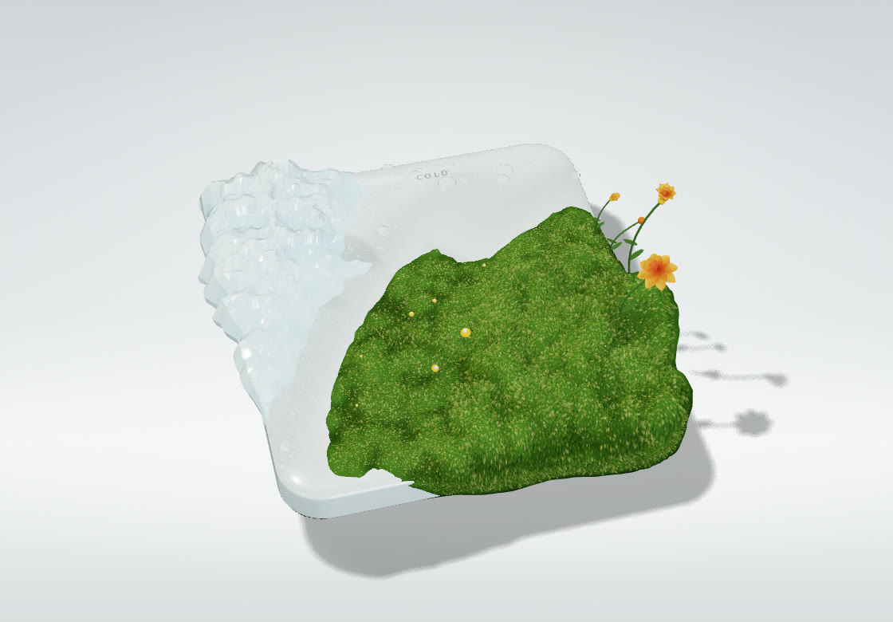
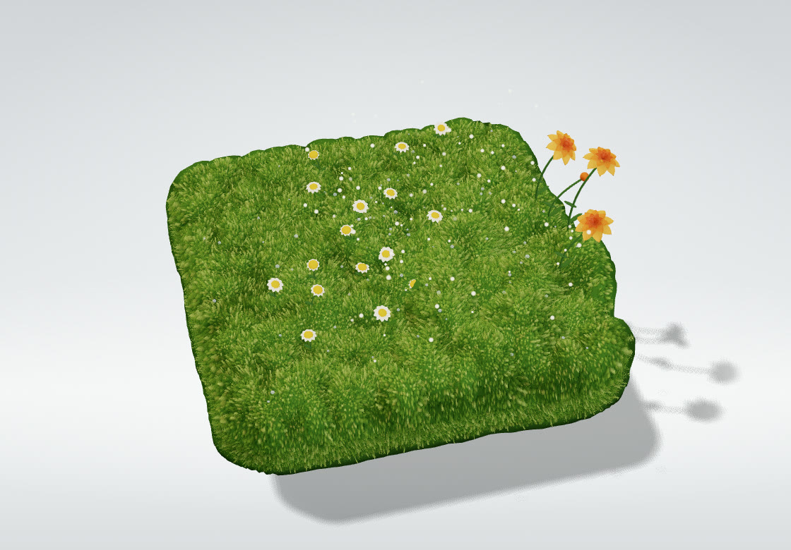
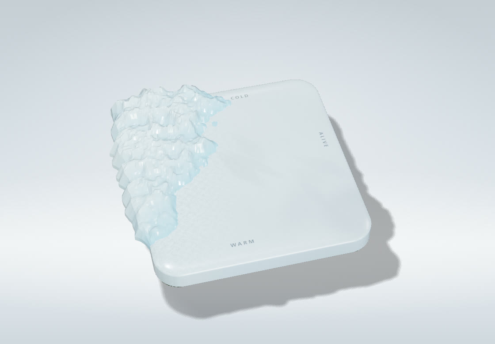
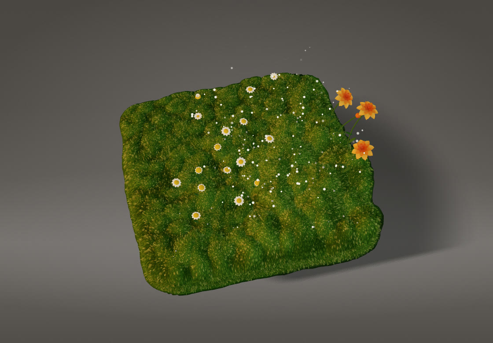

# Overgrowth

A slab of frosted glass in a grey studio. One number, growth, goes from 0 to 1, and the slab goes with it from
cold to alive: the ice in one corner melts and leaves drops behind, moss rises from the opposite corner and takes
the top and then the walls, and flowers open last. Everything is drawn in real time and every value is on a slider.

**Live demo:** https://kloserock97-tech.github.io/overgrowth/



This started as the loading screen of [my portfolio](https://kloserock97-tech.github.io/gorbachev-nikita-product-designer/):
the slab grew while the site loaded. Here it is out of the loader and on a panel.

## The idea

The whole scene is a function of one number. Nothing is simulated and nothing carries state from frame to frame:
for every vertex, drop and petal the code knows the growth value at which it starts to move and the value at which
it is done. That gives a few things for free:

- **Growth can be dragged.** Pull the slider back and the moss sinks into the glass and the ice comes back.
- **The loop is continuous.** The demo grows the slab, holds it, rewinds it and starts again, with no cut.
- **The same growth value always gives the same picture,** so a look can be shared as a link.

## How it works

**The slab.** A rounded box, rounded in 3D first and then squashed, so the corners stay round in plan while the
edge bevel stays tight. The glass is faked: an opaque body with a wet clear coat, walls that are cooler and darker
than the milky top (you look into the thickness there), a soft glow where light would pass through, cloudy density,
frost near the ice and soft leaf shadows from foliage that is out of frame. Real transmission would render the
scene twice. The reflections come from a small room built in code and prefiltered once, so nothing is downloaded.

**Layers that grow and melt.** Moss and ice are both sheets laid on the slab. Each vertex knows a point on the
surface, the normal there, a resting point just under the glass, and a delay. Moss moves from rest out to its full
height as growth passes its delay; ice does the opposite. Past the edge the sheet is wrapped down the wall and tucked
under the lip, so at 1 the whole solid is covered and no strip of glass is left.

**The front.** The delay field starts in the warm corner and reaches the cold one at about two thirds of the run.
The rest of the run is for the walls, the pile and the bloom. A soft contact shadow runs on the glass just ahead of
the moss, so the cushion stands on the slab instead of being pasted on it. Where the ice has gone, the glass stays
darker and much glossier for a while: a film of water.

**The moss is a shell-textured pile.** The cushion surface is drawn again and again, each copy pushed a bit further
out along the normal, and in every copy a mask keeps only small round cross-sections of strands, smaller the higher
the layer. No thin triangles, so nothing shimmers. Two lattices of strands at different scales, one turned against
the other and both bent by a slow warp, keep it from reading as a rubber mat. All layers go out in one instanced
draw call, and the number of layers is the main quality dial.

A few details that matter:

- The colour does the shading: dark at the root, yellow-green at the tip, lighter on the crowns of the knobs, with
  the odd dry or tall pale strand. Twenty overlapping layers cannot afford shadow lookups.
- Strand edges are antialiased with **alpha to coverage** on a 4× multisampled target. The same alpha would make the
  middle of the moss half transparent against the page, so the layers do not write alpha at all. A dark hull at the
  height of the tips writes it once for the whole pile, and gives the silhouette a clean edge too.
- A lattice cell is kept at about 3.6 device pixels whatever the screen, so a strand never gets thinner than a pixel.

**Drops, flowers, pollen.** Drops are flattened spheres that read as lenses: clear in the middle, a dark rim, one
hard highlight. They appear where the ice gives up the glass and vanish when the moss gets there; a little dew
stays on the moss. Three ranunculus and a bud at the warm edge lean out past it, daisies grow in loose drifts, and once the
corner is in bloom pollen drifts up in the light.

**The frame.** The scene goes into a half-float multisampled target, then a composite adds a little halation on the
brightest highlights, a vignette, our own tone curve and a fine grain. The canvas is transparent: the grey studio
behind it is plain CSS gradients, and the floor is only a shadow catcher.

## Controls

| Group | What it does |
| --- | --- |
| **Growth** | growth 0…1, grow by itself, length of one run, loop (hold, rewind, start again), freeze time, breeze speed |
| **On the slab** | switch the ice, moss, flowers, drops and dew, pollen and the COLD / WARM / QUIET / ALIVE captions; number of pollen specks |
| **Moss** | pile length, strand cell size in pixels, breeze, velvet sheen, root / tip / bright tip / dry strand colours |
| **Glass** | tint, matting, frost, leaf shadows, floor shadow |
| **Light** | sun height, direction, power and colour, shadow softness, fill, sky light, room reflections, exposure, halation, vignette, studio colour |
| **View** | lean to the pointer, float, camera angle, height and zoom, quality step (auto or pinned) |

`H` hides the panel, `Space` freezes time, `R` grows the slab again from zero. Move the pointer and the slab leans
towards it.

The settings sit in a sheet at the bottom of the page, one tab per group. Drag anywhere on a row to change a value,
double-click it to type one, or use the arrow keys. The buttons in the top right switch between a light and a dark
panel, fold the sheet and reset everything.

Five presets are included (thaw, spring, overgrown, frost, dusk). **New seeds** plants another garden: other
cushions, flowers and drops on the same slab. **Copy link to this look** puts the whole setup in the address bar.

| spring | overgrown |
| --- | --- |
|  |  |
| **frost** | **dusk** |
|  |  |

## Performance

The cost is the moss: up to twenty layers of the cushion surface, each running the strand mask per pixel. So the
quality steps change two things, the pixel ratio of the canvas and the number of layers:

| step | DPR cap | layers |
| --- | --- | --- |
| 0 | 2 | 20 |
| 1 | 1.75 | 16 |
| 2 | 1.5 | 13 |
| 3 | 1.25 | 10 |
| 4 | 1 | 8 |

On **auto** a desktop with 8 or more threads starts at step 0, a phone at step 2, anything else at step 1. If, over
a window of 30 frames, more than half arrive later than 26 ms, the scene drops one step. A single long stall does
not count. Pin a step on the panel to stop that.

Measured in headless Chrome on an Intel Arc integrated GPU, 1440×900, DPR 1, fully grown slab: about 65 fps on
step 0, 100 on step 2 and 117 on step 4. With the moss switched off the same scene runs at the 165 Hz of the display.
The whole start-up (renderer, the room for reflections, every part of the garden) takes about a third of a second.

## Running it

Node 22 or newer.

```bash
npm install
npm run dev       # http://localhost:5173
npm run build     # type check, then a static site in dist/
npm run preview
```

`.github/workflows/deploy.yml` publishes `dist/` to GitHub Pages on every push to `main`.

`src/Overgrowth.ts` is the stage: renderer, camera, light, quality steps and the frame. What lies on the slab is in
`src/garden/`: `surface.ts` (the slab shape and the fields of moss and ice), `sheet.ts` (the layer that grows or
melts), `slab.ts`, `ice.ts`, `moss.ts`, `flowers.ts`, `water.ts` (drops and pollen), `post.ts` (target and composite)
and `hash.ts`. `src/main.ts` runs the loop and the panel, `src/settings.ts` holds defaults, presets and the URL
encoding. There are no models, textures or data files, only code. `tools/shots.json` is the script that took the
screenshots above.

## Prior art

Shell texturing (drawing a surface many times along its normal and masking each layer) is a long-known technique
for fur, grass and moss in real-time graphics; this is my own take on it, and all of the code here is my own. Hashes
come from my own Hash Kit. Built with [three.js](https://threejs.org) (including its RoomEnvironment, PMREM and
RoundedBoxGeometry). The settings panel (`src/panel/`) is my own too.

## Licence

Source-available under the [PolyForm Noncommercial License 1.0.0](LICENSE): free for personal, study, research and
other noncommercial use. **Commercial use needs a paid license**, see [COMMERCIAL.md](COMMERCIAL.md) or write to
kloserock97@gmail.com. Third-party parts keep their own licenses, listed in
[THIRD_PARTY_NOTICES.md](THIRD_PARTY_NOTICES.md).

Nikita Gorbachev · kloserock97@gmail.com ·
[LinkedIn](https://www.linkedin.com/in/nikita-gorbachev-productdesigner)
